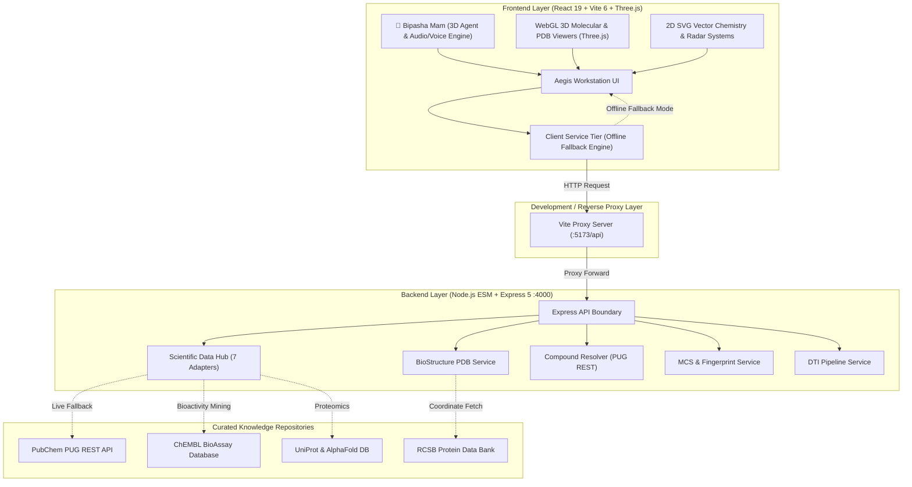

# 🧬 Aegis Molecular Platform
### AI-Powered Drug–Target Interaction & Computational Biology Workstation

[](https://nodejs.org/)
[](https://react.dev/)
[](https://vitejs.dev/)
[](https://threejs.org/)
[](https://expressjs.com/)
[](file:///workspaces/AI-Drug-Target-Interaction-Prediction/tests)
[](#license)

---

## 📌 Executive Summary

The **Aegis Molecular Platform** is an enterprise-grade, research-oriented computational chemistry, molecular biology, and drug discovery intelligence workstation. It bridges high-resolution 3D macromolecular visualization, quantum and empirical descriptor calculation, Maximum Common Substructure (MCS) graph alignment, pharmacokinetic profiling, and explainable deep-learning Drug–Target Interaction (DTI) predictions into a unified, dark-laboratory scientific interface.

Anchoring the workstation is **"Bipasha Mam"**, a persistent 3D AI research assistant and navigation agent positioned at the bottom-right corner of the application. The platform integrates authoritative structural and biochemical repositories—including the **Protein Data Bank (RCSB PDB)**, **PubChem**, **ChEMBL**, **UniProt**, and **AlphaFold**—with robust in-browser fallback computation, ensuring high availability both online and offline.

> [!IMPORTANT]
> **Scientific Research & Non-Clinical Safety Notice:**
> The Aegis Molecular Platform is engineered strictly for pharmaceutical research, computational chemistry modeling, and biomedical education. It does **not** provide clinical diagnosis, patient-specific medical advice, prescription generation, or dosage adjustments. In-silico predictions represent computational hypotheses that require experimental in-vitro/in-vivo laboratory validation.

---

## 🗺️ System Architecture



---

## 🔬 Core Workstation Modules

### 1. 🤖 "Bipasha Mam" — Persistent 3D AI Research Agent
* **Visual Representation:** A floating, luminescent emerald 3D AI orb positioned in the lower-right application viewport, featuring ambient particle halos, rotational torque, and scientific pulse states.
* **Multi-Stage Progress System:** Visual 5-stage progress indicator tracking operations across 0% to 100% (Identifier Resolution $\to$ Descriptor Synthesis $\to$ Target Topology $\to$ DTI Calibration $\to$ Dossier Ready).
* **Natural Language Intent Parser:** Semantic query engine parsing user requests (e.g., *"check ciprofloxacin interactions"*, *"explore 2XCT binding pocket"*, *"compare benzene and toluene"*) and navigating automatically to target modules.
* **Contextual Greeting Engine:** Dynamically adapts conversation greetings and quick-action triggers to the user's active viewport.
* **Audio & Voice Synthesis:** Web Audio API synthesized laboratory audio cues (chimes, clicks, alerts, ambient orb hums) and Web Speech API text-to-speech feedback.
* **Safety Boundaries:** Built-in ethical and non-clinical guardrails filtering out prescribing or medical advice requests.

---

### 2. 🧬 BioStructure Intelligence Hub (`BioStructureHubView`)
An advanced structural biology workspace inspired by RCSB PDB capabilities:

* **3D Macromolecular Complex Rendering:** High-performance WebGL rendering of multi-chain proteins, nucleic acids, bound crystallographic ligands, water molecules, and coordinated metal ions.
* **PDB Parser:** Complete client/server hierarchy parsing chains, residue sequences, secondary structure (alpha-helices, beta-sheets), resolution, space group, and deposition metadata.
* **Binding Site & Cavity Intelligence:** Automatic pocket identification with Voronoi/geometric grid volume calculations ($\text{\AA}^3$), Solvent Accessible Surface Area (SASA), and contact residue mapping within a 4.5Å Euclidean sphere.
* **Interaction Vector Calculation:** Detects and renders 3D dashed interaction vectors for hydrogen bonds (donor-acceptor $\le 3.5\text{\AA}$), salt bridges, $\pi$-stacking, and hydrophobic contacts.
* **Per-Residue Sequence Mapping:** Interactive amino acid sequence strip showing contact hot-spots, secondary structure types, and per-residue B-factor / pLDDT confidence metrics.
* **Experimental Quality Assessment:** Comprehensive diffraction analytics including R-work, R-free, resolution, and coordinate validation flags.
* **Cα Structural Alignment & RMSD:** Pairwise structural superimposition computing Root Mean Square Deviation (RMSD) and conformational variance.
* **AI Structure Interpreter:** Grounded structural query assistant answering geometric and biochemical inquiries about the active complex.

---

### 3. 🔬 Structure Comparison & Common Substructure Analysis (`StructureComparisonView`)
A cheminformatics module for pairwise molecular comparison:

* **Dual Compound Input:** Flexible selection of Compound A and Compound B via flagship libraries, SMILES, PubChem name, or chemical formulas.
* **Synchronized 2D/3D Viewers:** Side-by-side synchronized molecular inspectors with coordinate alignment and interactive orbit controls.
* **Maximum Common Substructure (MCS) Engine:** Graph-based Bron-Kerbosch clique algorithm calculating the largest common chemical core.
* **Visual Substructure Alignment:** Shared scaffolds highlighted in emerald green; divergent functional groups and substituents color-coded in orange/cyan.
* **Cheminformatics Metrics:** Exact quantitative similarity via Morgan circular topological fingerprints (Tanimoto coefficient, Dice similarity, Cosine distance).
* **Delta Property Comparison Table:** Calculates and formats absolute differences ($\Delta\text{MW}$, $\Delta\text{LogP}$, $\Delta\text{TPSA}$, $\Delta\text{HBD}$, $\Delta\text{HBA}$, $\Delta\text{RotBonds}$).
* **Comparative Bioactivity & Target Profiles:** Displays divergent target selectivities and binding mode shifts across congeners.

---

### 4. ⚗️ Visualize the Compound (`VisualizeCompoundView`)
A dedicated molecular inspection workstation:

* Dynamic compound resolution via PubChem PUG REST API.
* Multi-representation switching: **Ball & Stick**, **Spacefill (van der Waals radii)**, **Wireframe / Sticks**, and **Backbone**.
* Atom-level hover tooltip showing element name, atomic index, hybridization state, and 3D spatial coordinates.
* Export molecular conformers as V2000 `.mol`, `.sdf`, high-resolution `.png`, or `.json`.

---

### 5. 🧪 Molecule Lab (`MoleculeLabView`)
An interactive molecular exploration and 3D preset viewing workspace:

* **3D Preset Molecular Visualization:** Interactive Three.js WebGL canvas displaying preset chemical models and conformers.
* **Multi-Representation Switching:** Support for Ball & Stick, Spacefill (CPK), Wireframe, and Surface representations.
* **Deterministic Descriptors:** Molecular weight, atom/bond topology, and elemental composition calculation.
* **Smooth Interactive Controls:** Orbit, zoom, pan, and auto-rotation tools for educational inspection.

---

### 6. ⚡ Additional Discovery Modules
* **DTI Prediction Lab (`DtiLabView`):** Multi-target screening console scoring binding probability and affinity metrics.
* **Target Analysis Workstation (`TargetAnalysisView`):** Macromolecular target inspector cataloging signaling pathways and cellular locations.
* **Scientific Data Integration Hub (`ScientificIntegrationsView`):** Live scientific integration console across 7 major databases with provenance badges and latency telemetry.
* **Medicine Cabinet & Expiry Monitor (`Medicines.jsx` & `ExpiryMonitorView.jsx`):** Clinical sample tracker with a 7-day expiry classification window and storage monitoring.
* **Research Hub (`ResearchHubView.jsx`):** Evidence synthesis, methodology matrices, and publication literature analysis.

---

## 🛠️ Technology Stack

| Layer | Technologies | Purpose |
| :--- | :--- | :--- |
| **Frontend Framework** | React 19, Vite 6 | High-speed component rendering, reactive state management, and modern build tooling |
| **3D Molecular Graphics** | Three.js (r186), WebGL | Hardware-accelerated 3D protein, ligand, and binding pocket rendering |
| **Icons & Typography** | Lucide React, Space Grotesk, Manrope, DM Mono | Scientific dark laboratory aesthetic and monospace data displays |
| **Audio & Speech** | Web Audio API, Web Speech API | Synthesized laboratory sound effects and natural voice readback for Bipasha Mam |
| **Backend Runtime** | Node.js (v20+ ESM), Express 5 | Asynchronous REST API boundary, CORS handling, and computational pipelines |
| **Cheminformatics** | Custom graph algorithms, Morgan circular fingerprints | Tanimoto similarity, MCS Bron-Kerbosch, Lipinski/Veber/Ghose descriptors |
| **External Integrations** | PubChem PUG REST, RCSB PDB REST, ChEMBL | Live structural data, chemical resolution, and bioactivity assay retrieval |
| **Testing** | Native Node.js Test Runner (`node:test`) | Unit, integration, and algorithmic benchmark test suite |

---

## 🚀 Getting Started

### Prerequisites
* **Node.js**: `v20.0.0` or higher
* **npm**: `v10.0.0` or higher

### 1. Installation
Clone the repository and install project dependencies:
```bash
git clone https://github.com/Shailesh8708/AI-Drug-Target-Interaction-Prediction.git
cd AI-Drug-Target-Interaction-Prediction
npm install
```

### 2. Environment Configuration
Create a `.env` configuration file from the example:
```bash
cp .env.example .env
```
Default configuration values:
```env
PORT=4000
VITE_API_BASE_URL=
```

### 3. Running the Application

#### Option A: Run Full Stack (Frontend + Backend Together) — Recommended
```bash
npm run dev
```
* **Frontend Application:** [http://localhost:5173](http://localhost:5173)
* **Backend Express API:** [http://localhost:4000/api/health](http://localhost:4000/api/health)
* The frontend automatically proxies `/api/*` requests to the backend server at port `4000`.

#### Option B: Run Services Individually in Separate Terminals
```bash
# Terminal 1: Launch Backend API Server
npm run dev:server

# Terminal 2: Launch Frontend Client
npm run dev:client
```

---

## 🔌 REST API Reference

The backend Express server exposes endpoints under `/api`:

### 🩺 System & Health
| Method | Endpoint | Description |
| :--- | :--- | :--- |
| `GET` | `/api/health` | Returns API status, service name, and execution phase |
| `GET` | `/api/models` | Returns available machine learning model registry entries |

### 🌐 Scientific Data Hub & Integrations
| Method | Endpoint | Description |
| :--- | :--- | :--- |
| `GET` | `/api/integrations/status` | Live status for 7 databases (PubChem, ChEMBL, UniProt, PDB, AlphaFold, DrugBank, BindingDB) |
| `GET` | `/api/science/search?q={query}` | Cross-database federated query resolution |
| `GET` | `/api/science/compound/:identifier` | Multi-source normalized compound resolution |
| `GET` | `/api/science/protein/:identifier` | Unified protein targets with sequence, domains, and PDB IDs |
| `GET` | `/api/science/compound/:identifier/bioactivity` | Quantitative bioassays (IC50, Ki, Kd) from ChEMBL & BindingDB |
| `GET` | `/api/science/target/:identifier/ligands` | Known interacting ligands and experimental affinities |

### ⚡ AI Drug–Target Interaction & Machine Learning
| Method | Endpoint | Description |
| :--- | :--- | :--- |
| `POST` | `/api/dti/predict` | Compute Morgan fingerprint + composition vector and predict binding affinity |
| `GET` | `/api/datasets/status` | Registry status of verified benchmark datasets (BindingDB, Davis, KIBA) |
| `POST` | `/api/datasets/prepare` | Scaffold splitting, normalization, and dataset preparation |

### 🧬 Structural Biology & RCSB PDB
| Method | Endpoint | Description |
| :--- | :--- | :--- |
| `GET` | `/api/structure/:id` | Parse and retrieve 3D macromolecular complex hierarchy for a PDB ID |
| `GET` | `/api/structure/:id/pocket` | Calculate binding pocket volume, SASA, and contact residues within 4.5Å |
| `GET` | `/api/structure/similar-molecules` | Calculate Morgan circular fingerprint Tanimoto structural similarity |
| `POST` | `/api/structure/align` | Perform pairwise Cα structural alignment and compute RMSD |
| `POST` | `/api/structure/ask` | Grounded AI Q&A answering structural biology inquiries about a complex |

### 🔬 Compound Resolution & Comparison
| Method | Endpoint | Description |
| :--- | :--- | :--- |
| `GET` | `/api/compounds/resolve?q={query}` | Resolve compound identifiers via PubChem PUG REST |
| `GET` | `/api/compounds/autocomplete?term={q}` | Fast autocomplete for chemical names and formulas |
| `POST` | `/api/compounds/compare` | Compare two compounds; compute MCS and delta descriptors |

---

## 🧪 Testing & Validation

The test suite runs using Node's native test runner (`node:test`) and asserts algorithmic correctness, chemistry parsing integrity, and API contracts.

Run the test suite:
```bash
npm test
```

### Test Coverage (33 Passing Tests)
```text
✔ BioStructure: Parses 2XCT PDB coordinates and extracts complex hierarchy
✔ BioStructure: Calculates binding pocket, contacts, and volume for 2XCT
✔ BioStructure: Circular topological fingerprint Tanimoto similarity search
✔ BioStructure: Pairwise Cα structural alignment computes RMSD and differences
✔ BioStructure: AI Structure Interpreter answers grounded questions safely
✔ BioStructure: Generates comprehensive publication report with disclaimer
✔ Action Registry contains all 10 required project modules
✔ Staged progress bar returns valid stage definitions across 0-100%
✔ Intent parser accurately maps natural language requests to actions
✔ Intent parser enforces non-clinical and non-prescriptive safety boundaries
✔ Contextual greetings adapt properly to active route
✔ Drug Intelligence: Flagship library contains authentic data across 10 drug classes
✔ Drug Intelligence: Resolves Ciprofloxacin profile with full molecular & target intelligence
✔ Drug Intelligence: Universal search recognizes drug names, synonyms, and target mechanisms
✔ Drug Intelligence: Evaluates Pairwise Drug-Drug Interaction (DDI) & CYP enzyme competition
✔ Drug Intelligence: AI Drug Analyst generates grounded answers strictly based on pharmacology
✔ Drug Intelligence: In-silico DTI predictor outputs explainable feature attributions
✔ Drug Intelligence: Generates publication-grade research report in Markdown with safety disclaimer
✔ classifies medicines inside the default seven-day window
✔ template insertion creates a structured aromatic graph
✔ atom and bond editing updates deterministic descriptors
✔ empty and malformed structures are reported without fabricated chemistry
✔ MOL export preserves the graph rather than rendering a screenshot
✔ simple SMILES becomes an editable graph and malformed input is rejected
✔ PDB parsing preserves protein hierarchy and imported metadata
✔ nearby residue candidates use imported 3D coordinates and explicit cutoff
✔ unsupported mmCIF input is reported instead of silently parsed
✔ Test 1 — Benzene vs Toluene: identifies benzene core MCS and methyl addition
✔ Test 2 — Ethanol vs Methanol: calculates molecular formula and descriptor differences
✔ Test 3 — Caffeine vs Theobromine: compares purine rings and methyl substituents
✔ Test 4 — Structurally unrelated molecules: handles low similarity safely
✔ Test 5 — Invalid / empty inputs: rejects safely without crashing
✔ Test 6 — MCS search timeout protection works gracefully

ℹ tests 33 | pass 33 | fail 0 | duration_ms ~1500ms
```

### Production Build Validation
Verify that the React/Vite bundle builds with zero errors or syntax warnings:
```bash
npm run build
```

---

## 📁 Repository Structure

```text
.
├── server/
│   ├── index.js                            # Express 5 API application & endpoint routes
│   └── services/
│       ├── bioStructureService.js          # PDB coordinate parsing, pocket analysis & RMSD
│       ├── compoundResolver.js             # PubChem PUG REST integration & SDF parser
│       ├── drugIntelligenceService.js      # Drug library, DDI engine, Q&A, and in-silico DTI
│       └── structureComparison.js          # MCS Bron-Kerbosch algorithm & fingerprint math
├── src/
│   ├── App.jsx                             # Master application layout, navigation, notice bar
│   ├── main.jsx                            # Application entry point
│   ├── components/
│   │   ├── bipasha/                        # "Bipasha Mam" 3D AI agent components
│   │   │   ├── BipashaAgent.jsx            # Floating 3D AI agent interface & controls
│   │   │   ├── BipashaOrbCanvas.jsx        # Three.js 3D emerald circular orb canvas
│   │   │   ├── BipashaProgressBar.jsx      # 5-stage visual progress bar (0-100%)
│   │   │   ├── BipashaActionRegistry.js    # Module registry, intent parser, safety guards
│   │   │   ├── BipashaSoundEngine.js       # Web Audio API procedural sound synthesizer
│   │   │   └── bipasha.css                 # Glassmorphic orb and agent styling
│   │   ├── biostructure/                   # BioStructure Intelligence Hub
│   │   │   ├── BioStructure3DViewer.jsx    # Three.js macromolecular WebGL canvas
│   │   │   ├── BioStructureSequenceView.jsx# Per-residue interaction & sequence strip
│   │   │   ├── BioStructurePocketsPanel.jsx# Binding pocket volume & contacts inspector
│   │   │   ├── BioStructureReportModal.jsx # Publication-grade dossier generator
│   │   │   └── biostructure.css            # Structural biology styles
│   │   ├── comparison/                     # Structure Comparison module
│   │   │   ├── StructureComparisonViewer.jsx# Synchronized 2D/3D dual inspectors
│   │   │   ├── MCSHighlightCanvas.jsx      # Substructure overlay canvas
│   │   │   └── comparison.css              # Side-by-side comparison styles
│   │   ├── views/                          # Page view components
│   │   │   ├── BioStructureHubView.jsx     # BioStructure Intelligence Hub page
│   │   │   ├── DtiLabView.jsx              # DTI prediction screening lab
│   │   │   ├── StructureComparisonView.jsx # Structure Comparison page
│   │   │   ├── VisualizeCompoundView.jsx   # Compound 2D/3D visualization page
│   │   │   ├── MoleculeLabView.jsx         # 3D molecule preset laboratory
│   │   │   ├── TargetAnalysisView.jsx      # Biological target analysis page
│   │   │   ├── ScientificIntegrationsView.jsx # Live scientific data integrations
│   │   │   ├── Medicines.jsx               # Personal medicine cabinet
│   │   │   ├── ExpiryMonitorView.jsx       # Medicine expiry tracking
│   │   │   ├── ResearchHubView.jsx         # Research methodology & publications
│   │   │   └── AnalyticsView.jsx           # Model metrics & pipeline telemetry
│   │   └── shared/                         # Reusable navigation, disclaimer & UI cards
│   └── services/                           # Client-side communication & offline fallbacks
│       ├── api.js                          # Base API fetch client
│       ├── bioStructureService.js          # Client PDB loader & pocket calculation
│       ├── molecularModel.js               # SMILES parser & descriptor math
│       ├── proteinModel.js                 # Residue & chain models
│       └── structureComparisonService.js   # Client comparison caller & fallback math
├── tests/                                  # Node.js automated test runner suites
│   ├── bioStructure.test.js                # BioStructure Hub & pocket tests
│   ├── bipasha.test.js                     # Bipasha Mam agent & navigation tests
│   ├── dtiPipeline.test.js                 # DTI ML pipeline & fingerprint tests
│   ├── expiry.test.js                      # Expiry classification domain test
│   ├── molecularModel.test.js              # Molecular graph & descriptor tests
│   ├── proteinModel.test.js                # Protein parsing & residue tests
│   ├── scientificDataHub.test.js           # Multi-database adapter tests
│   ├── structureComparison.test.js         # MCS & comparison tests
│   └── universalProtein.test.js            # Universal protein engine tests
├── package.json                            # Scripts, dependencies, and configuration
├── vite.config.js                          # Vite bundler & reverse proxy configuration
└── README.md                               # Comprehensive documentation
```

---

## 🔒 Scientific Governance & Data Integrity

1. **Experimental vs. Predicted Separation:**
   Every analytical panel visibly marks data sources with explicit badges:
   * `[Experimental]`: Direct X-ray crystallography, NMR, or wet-lab bioassay measurements.
   * `[Curated]`: Manually reviewed literature from FDA labels, DailyMed, or PharmGKB.
   * `[Calculated]`: Empirical cheminformatics metrics (e.g., Lipinski descriptors, Morgan fingerprints).
   * `[Predicted]`: Machine learning model inferences requiring laboratory confirmation.

2. **Deterministic Computation:**
   Molecular properties (molecular weight, hydrogen bond counts, rotatable bonds, topological polar surface area) are computed deterministically from verified molecular graphs rather than hallucinated by language models.

3. **Client-Side Resilience:**
   All major workstations incorporate local fallback algorithms and embedded reference libraries, ensuring that the platform remains interactive and fully explorable even in disconnected environments.

---

## 📄 License

This project is licensed under the **MIT License**. See the `LICENSE` file for details.
